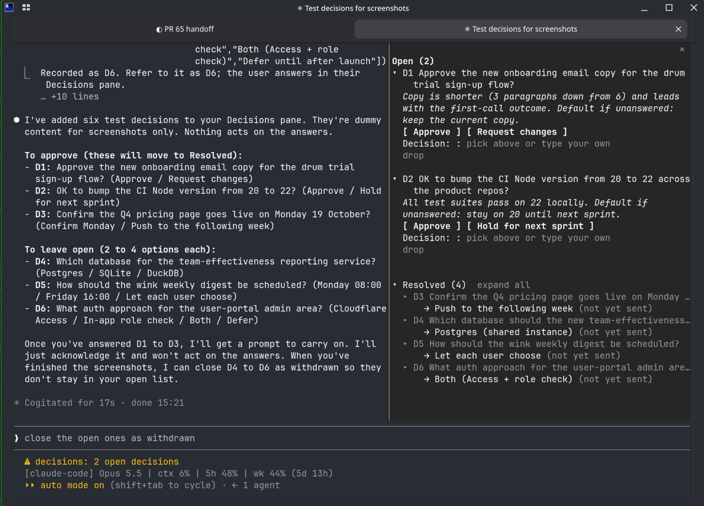

# decisions

A Claude Code mod that stops open decisions getting lost in the chat.

When Claude needs you to choose something (an approach, an assumption, a missing fact), it logs the question as a decision with a reference: D1, D2, and so on. The decisions sit in a side pane while work carries on, and you answer them whenever you are ready.



## Install

In a Claude Code terminal session:

```
/plugin install decisions --marketplace cga-management/claude-decisions
```

Answer `y` to add the marketplace, then pick a scope (user scope loads it in every session).

## Using it

- **Answer in the pane:** click an option, or type in the Decision box and press Enter. Click `▸ D1` to expand or collapse a decision and read its background.
- **Answer from the prompt:** `/decide D2 <your answer>`, or `/decide D2 drop` to discard one.
- **`/decisions`** opens the pane; **`/decisions clear`** removes resolved ones. Under Resolved, click `▸ D1` (or "expand all") to see a decision in full: question, background, options and answer.
- **Answered in the chat instead?** Claude closes the decision itself (its `close_decision` tool), and the Resolved list marks it "settled in chat".
- The status line shows how many decisions are open.

How answers reach Claude:

- **Mid-task:** the answer arrives with Claude's next tool result, so it can change course without stopping.
- **Idle:** once every decision Claude raised in a turn is answered or dropped, the mod prompts Claude to carry on with the work.
- Otherwise the answer comes along with your next message. Each answer is sent once.

Decisions are kept per project folder, so a new or resumed chat in the same folder still shows the open ones (the last 30 resolved are kept too).

Notes: the pane opens by itself on terminals 144 columns or wider; run `/decisions` on narrower ones. Claude decides when to log a decision; you can also ask it to "log that as a decision".

## Developing

```
claude plugin validate .
claude plugin test .
```

To run a working copy: `claude --plugin-dir /path/to/claude-decisions`.

## Licence

MIT. See [LICENSE](LICENSE).
